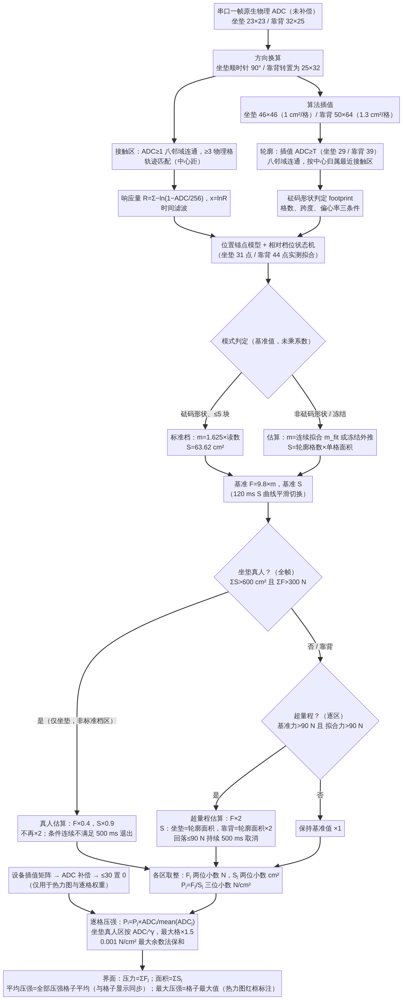

# 恩迪坐垫/靠背：面积、压力、压强完整计算逻辑说明

**适用版本：** 汽车座椅标定上位机 V2.7.110（恩迪坐垫 23×23、恩迪靠背 32×25）
**依据：** 当前源码 `endiCushionCore.js`、`endiBackrestCore.js`、`endiSeatForce.ts`、`endiBackrestForce.ts`、`endiPointPressure.ts`、`pressureUnits.ts`、`adcCompensation.ts`、`Home.tsx`
**整理日期：** 2026-11-13

## 0. 名词与单位约定

本软件中的“压力”指**力**，单位 N；“压强”指单位面积上的力，单位 **N/cm²**；“面积”单位 cm²。程序内部的压强字段仍以 kPa 存储（字段名带 `KPa`），换算关系为 **1 N/cm² = 10 kPa**，内部最小取整单位 0.01 kPa，正好等于界面显示的 0.001 N/cm²，因此显示时不会发生二次舍入。

| 量 | 符号 | 界面单位 | 界面精度 | 内部存储 |
| --- | --- | --- | --- | --- |
| 质量（中间量） | m | kg | 仅用于标签 | kg |
| 压力（力） | F | N | 2 位小数 | N，2 位小数 |
| 面积 | S | cm² | 2 位小数 | cm²，2 位小数 |
| 压强 | P | N/cm² | 3 位小数 | kPa，0.01 kPa |

全部计算使用 **g = 9.8 m/s²**，即 F = 9.8 × m。标准砝码块质量 **1.625 kg/块**，砝码底面积 **63.62 cm²**。

## 1. 总体数据链路

一帧数据进入后分成两条并行路径，**这一点最重要，不能混用**：

| 路径 | 输入 | 用途 |
| --- | --- | --- |
| 算法路径 | 串口解码的**原生物理 ADC，未经 ADC 补偿** | 接触区识别、砝码块数识别、压力 F、面积 S、各区压强 Pⱼ |
| 显示路径 | 设备插值矩阵 → ADC 补偿 → 补偿后 ≤30 置 0 | 热力图 ADC 显示、ADC 类统计卡片、逐格压强的**分配权重** |

也就是说，ADC 补偿公式只改变热力图和逐格压强在区内的分布形状，**不改变**任何一个区的压力、面积和区压强。

## 2. 传感器几何与方向

| 项目 | 坐垫 | 靠背 |
| --- | --- | --- |
| 上位机原生矩阵 | 23×23 | 32×25 |
| 进入算法前的方向换算 | 顺时针旋转 90°：`alg[r][c] = native[22−c][r]` | 转置为 25×32 |
| 物理点距 | 20 mm × 20 mm | 行距 20 mm，列距 26 mm |
| 算法插值矩阵 | 46×46 | 50×64 |
| 插值格尺寸 | 10 mm × 10 mm | 10 mm × 13 mm |
| **单格面积** | **1 cm²** | **1.3 cm²** |
| 拟合数据 | 31 个位置 × 1–5 块 | 44 个落点 × 2 轮 × 5 档 × 20 帧 = 8800 帧 |
| 轮廓阈值 T | 插值 ADC ≥ 29 | 插值 ADC ≥ 39 |

**坐垫插值：** 列方向 `t[r][2c+1] = a[r][c]`，`t[r][2c] = (a[r][c−1] + a[r][c]) / 2`；行方向 `b[2r] = t[r]`，`b[2r+1] = (t[r] + t[r+1]) / 2`；越界按 0 处理，结果向下取整并限幅 0–255。物理点 (r, c) 对应插值格 (2r, 2c+1)。

**靠背插值：** `b[2r][2c] = a[r][c]`，`b[2r][2c+1] = (a[r][c] + a[r][c+1]) / 2`，`b[2r+1] = (b[2r] + b[2r+2]) / 2`；越界按 0，向下取整并限幅 255。

## 3. 共同前处理：接触区、轮廓与砝码形状

### 3.1 接触区（决定“有几个受力区”）

在算法方向的未补偿物理 ADC 上，取 **ADC ≥ 1** 的点做**八邻域连通**，连通块至少 **3 个物理格**才算一个接触区。每个接触区计算 ADC 加权中心、峰值 ADC（peak）和响应量 R（见 4.1）。帧与帧之间按中心距离匹配成“轨迹”：坐垫 ≤ 3 个物理格（60 mm），靠背 ≤ 60 mm；连续 2 帧未匹配则删除该轨迹及其全部状态。

### 3.2 轮廓（决定“面积”）

在算法插值矩阵上取 **ADC ≥ T**（坐垫 29、靠背 39）的格子做八邻域连通，每个连通块按其 ADC 加权中心归属到**最近的接触区**。一个接触区的轮廓格数记为 **NT**（归属到它的全部轮廓块格数之和）。

### 3.3 砝码形状判定（footprint）

对每个轮廓块计算格数 N、跨度 span（行跨度与列跨度的较大者）和偏心率 ecc（ADC 加权二阶矩两个特征值之比的平方根）。三个条件**全部满足**才算“像一块标准砝码”：

| 条件 | 坐垫 | 靠背 |
| --- | --- | --- |
| 格数 N | 39 ≤ N ≤ 131 格 | 32 ≤ N ≤ 102 格 |
| 跨度 | ≤ 16 格（160 mm） | ≤ 182 mm |
| 偏心率 | ≤ 1.734 | ≤ 1.704 |

一个接触区 **恰好只有 1 个轮廓块并且该块满足上述条件**时，`footprint = true`（砝码形状）；否则 `footprint = false`（非砝码形状，例如真人、多块并排、斜放或局部按压）。

## 4. 压力（力）标定逻辑

### 4.1 响应特征

每个接触区的响应量：**R = Σ −ln(1 − ADC/256)**（ADC 先限幅到 255），取 **x = ln R** 作为识别特征。时间滤波：坐垫对 x 做 3 帧中值，再用“混合读数”（最近 3 个中值的极差 ≤ 0.049 时取其均值，否则取当前值）；靠背对 x 做 120 ms 时间平均（约相邻 2 帧），用于抑制逐帧交替的共模波动。

### 4.2 位置锚点模型（实测拟合的核心）

同样的砝码放在不同位置，传感器响应不同，因此每个标定位置都存储了 1–5 块砝码对应的实测 lnR 锚点。对当前接触区中心，按高斯距离权重插值得到该位置的期望曲线：

> lvₙ(位置) = Σ wᵢ·lᵢ,ₙ / Σ wᵢ，wᵢ = exp(−dᵢ² / 2σ²)

| 参数 | 坐垫 | 靠背 |
| --- | --- | --- |
| 锚点数 | 31（P01–P31） | 44 |
| 距离单位与 σ | 物理格，σ = 2.5 格（50 mm） | mm，σ = 35 mm |
| 档距 Dₙ | lvₙ₊₁ − lvₙ | lₙ₊₁ − lₙ |
| 5 块以上外推 | 档距逐档 × 0.72 | 档距逐档 × 0.8 |

### 4.3 相对档位 λ

确认了某一档后，记录基准档 L 及其实测特征 A。之后用 λ（连续档位）判断加块或减块：

1. 以基准 (L, A) 为零点，构造各档的期望偏移 Eₙ（E_L = 0）。
2. **坐垫：** 实测与锚点的偏差 e = A − lv_L 按系数逐档传递，向上 ρ_up = [0.630, 0.778, 0.869, 0.808]，向下 ρ_dn = [1.182, 1.178, 1.062, 1.165]，每档增量不少于 0.3×Dₙ。
3. **靠背：** 采用“比例缩放”模型，先求基准 A 在本位置曲线上对应的绝对档位 n_A，缩放系数 s = n_A / L（限制在 0.5–2），期望偏移 Pₙ = 曲线(s·n) − 曲线(s·L)。
4. 若该轨迹在有效期内（靠背 10 s）曾确认过某档，则该档用**历史实测锚点**替代预测值。
5. 设 d = x − A：d 在 Eₙ 与 Eₙ₊₁ 之间时 **λ = n + (d − Eₙ)/(Eₙ₊₁ − Eₙ)**；低于 1 块时 λ = exp(d − E₁)。

首次确认前没有基准，使用绝对读数：x ≤ lv₁ 时为 exp(x − lv₁)，否则为最近档 n + u((x − lvₙ)/Dₙ)。

### 4.4 读数映射 u（让整档读数稳定、偏离时连续）

> u(t) = a·t + b·t³ / (t² + c²)，a = 0.08，b = 0.92，c = 0.35

当 |u| > 0.8 时软限幅为 0.8 + 0.2·(1 − e^(−(|u|−0.8)/0.2))。标准档质量 **m = 1.625 × (L + u(λ − L))**。效果是：λ 只偏离 0.1 档时读数只变化约 0.015 块（读数贴近整档），偏离 0.5 档时读数变化约 0.35 块，偏离越大越接近线性。

### 4.5 档位状态机

| 状态 | 进入/提交条件（坐垫） | 靠背差异 |
| --- | --- | --- |
| 首次接触确认中 | 接触 ≥ 300 ms 且出现平台，且 R ≥ 0.6×（本位置 1 块的 R），轻触不计 | 相同（300 ms、0.6） |
| 暂定档 | 首次 400 ms 稳定提交；加减块 600 ms 提交；偏离 ≥ 0.25 档退出；预提交 400 ms 且残差不低于 −0.3 | 暂定稳定 400 ms 提交，偏离 0.25 退出 |
| 已确认 | \|λ − L\| ≥ 0.25 进入加减判断；\|λ − L\| < 0.2 时蠕变跟随 A ← A + (x − A)·min(1, dt/2000 ms) | 蠕变带 0.25、τ = 1000 ms；同档 600 ms 内 λ 极差 < 0.15 时重新锚定 |
| 加减块判断中 | 平台判定后 k = round(λ − L)；残差 ≤ 0.4 为清晰，否则模糊 3 s 超时后裁决；700 ms 内续接（步长比 0.75）防止重复计数；L + k < 1 时清零回首次 | 续接比 0.70；反向续接可撤销上一步；模糊 ≥ 1 s 用绝对锚点裁决 |

平台判定：坐垫相邻差 ≤ 0.018、极差 ≤ 0.029（3 帧、150 ms），快速平台 2 帧/80 ms、偏差 ≤ 0.3；靠背相邻差 ≤ 0.021、极差 ≤ 0.033，窗口 150 ms/3 帧，快速 80 ms/2 帧。

### 4.6 连续拟合（非砝码形状、无基准时使用）

| 项目 | 坐垫 | 靠背 |
| --- | --- | --- |
| 特征 | R = Σ −ln(1 − ADC/256) | Q = Σ ADC²（120 ms 均值） |
| 公式 | **m_fit = exp(−1.44300 + 1.39231 × ln(g(p)·R))** | **m_fit = exp(−12.04558 + 1.13724 × (ln g(p) + ln Q))** |
| 位置增益 g(p) | 31 点增益高斯加权（σ = 2.5 格） | 44 点增益高斯加权（σ = 35 mm），约 0.796–1.176 |

这里 g(p) 是位置增益（不是重力加速度），由实测数据拟合。

### 4.7 冻结外推

如果某轨迹**已经确认过砝码档位**，随后轮廓变得不像砝码（footprint = false），则冻结状态机，质量改为 **m = 1.625 × max(0, λ)**，即沿该轨迹的相对曲线外推。另外，当基准估算力 **9.8 × m > 90 N**（或档位、暂定档超过 5 块）时也冻结计数，不再按“标准档”加减块；轮廓恢复为砝码形状且估算力回落到 ≤ 90 N 并持续 500 ms 后才恢复计数。冻结只影响计数，是否乘 ×2 由 4.8 的超量程标记决定。

### 4.8 超量程估算（V2.7.103 新规则；V2.7.108 起靠背面积 × 2）

| 项目 | 规则 |
| --- | --- |
| 启动 | 接触区**基准估算力 9.8 × m > 90 N**，**且**连续拟合估算力 **9.8 × m_fit > 90 N**（双重确认超过 5 块砝码；5 块 = 79.63 N，6 块 = 95.55 N），满足即启动 |
| 处理 | 该区压力 **× 2**。面积：坐垫取轮廓面积 NT × 1 cm²（面积不乘倍率）；靠背取轮廓面积 **NT × 1.3 cm² × 2**（V2.7.108 起；区压强 = 2F / 2S = F / S，与未超量程时“基准力 / 轮廓面积”相同） |
| 取消 | 两个估算力中任一回落到 ≤ 90 N，并**连续保持 500 ms** 后取消；中途重新满足则重新计时 |
| 已删除的旧条件 | 坐垫 m_fit > 9.6 kg / 峰值 > 185 / λ > 5.5 / 档位 > 5 块（退出 9.1 / 176 / 5.3）；靠背 m_fit > 9.4 kg 持续 150 ms / 峰值 > 184 / λ > 5.5（退出 9.0 / 176 / 5.3） |

这里的 m 是未乘任何倍率的“基准质量”（标准档读数、冻结外推值或连续拟合值）。之所以要求两个估算力同时超过 90 N：在真实 1–5 块标定数据中，有 2 个文件的 5 块段被状态机短暂多估为 91.95 N、104.78 N（实际只有 5 块），若只看状态机读数会误乘 ×2；加上连续拟合交叉确认后，坐垫 6200 帧、靠背 8800 帧标定数据中超量程误触发均为 0。实现位置：坐垫的 ×2 在适配层施加（核心输出基准值和 over 标记）；靠背的压力 ×2（`overrangeMultiplier`）与面积 ×2（`overrangeAreaMultiplier`，V2.7.108 新增）都在核心内施加。

### 4.9 模式判定与最终压力

| 模式 | 条件 | 质量 m | 面积 S（见第 5 节） |
| --- | --- | --- | --- |
| 标准档 | 砝码形状、未冻结、未超量程 | 1.625 × (L + u(λ − L)) | 63.62 cm² |
| 估算 | 非砝码形状，或已冻结 | 无基准：m_fit；有基准：1.625 × max(0, λ) | NT × 单格面积 |
| 超量程估算 | 超量程标记成立（4.8） | 上一行的结果 × 2 | 坐垫 NT × 1 cm²；靠背 NT × 1.3 cm² × 2 |
| 真人估算（仅坐垫） | 全帧真人条件成立（第 7 节），且该区不是标准档 | 上两行的基准值 × 0.4（不再 × 2） | NT × 1 cm² × 0.9 |

核心模式切换时，m 和 S 都按 **120 ms S 曲线**（3τ² − 2τ³）平滑过渡；坐垫适配层的系数（×1、×2、真人 ×0.4/×0.9）在类别切换时同样按 120 ms S 曲线过渡。每区压力 **Fⱼ = 9.8 × mⱼ**。上位机的“压力平滑”对恩迪传感器不再叠加处理（算法内部已经滤波），直接显示算法当帧结果。

## 5. 面积逻辑

| 情况 | 每区面积 Sⱼ |
| --- | --- |
| 标准档（砝码形状识别成功） | 固定为砝码底面积 **63.62 cm²**（NT > 0 时；NT = 0 时为 0） |
| 估算 / 超量程估算（坐垫） | **NT × 1 cm²**（超量程只乘压力，不乘面积） |
| 估算（靠背） | **NT × 1.3 cm²** |
| 超量程估算（靠背） | **NT × 1.3 cm² × 2**（V2.7.108 起；V2.7.103–V2.7.107 为 NT × 1.3 cm²） |
| 坐垫真人估算区 | **NT × 1 cm² × 0.9**（见第 7 节） |

全帧面积 = 各区 Sⱼ 之和，保留 2 位小数。**标准档不按轮廓格数计面积**，而是使用砝码的真实底面积；只有估算类区域才用轮廓格数。

**框选时的面积**另走统计：坐垫取框内补偿前插值 ADC ≥ 29 的格数 × 1 cm²，再对框内属于真人估算区的格子每格扣减 0.1 cm²（即 × 0.9）；靠背取框内 ADC ≥ 39 的格数 × 1.3 cm²，框内属于超量程估算区的格子每格再加 1.3 cm²（即 × 2，V2.7.108 起，与全帧面积口径一致）。因此，框选完整罩住一块标准砝码时，面积显示的是该砝码的轮廓格数，而不是 63.62。

## 6. 压强逻辑

### 6.1 区压强（每个接触区一个值）

先把各区压力和面积取整：Fⱼ 保留 2 位小数 N，Sⱼ 保留 2 位小数 cm²，再计算

> **Pⱼ = Fⱼ / Sⱼ**（N/cm²，保留 3 位小数；内部 10·Fⱼ/Sⱼ kPa，保留 0.01 kPa）

区压强完全由该区的压力和面积决定，**没有单独的“压强标定曲线”**。

### 6.2 逐格压强（热力图每个格子）

逐格压强是把区压强按 ADC 比例分配到格子上，**不是逐点独立标定**：

> **Pᵢ = Pⱼ × ADCᵢ / mean(ADCⱼ)**

| 要素 | 规则 |
| --- | --- |
| 哪些格子有压强 | 只有属于某个接触区轮廓（坐垫 ≥ 29、靠背 ≥ 39，归属规则与算法核心完全相同）的格子；轮廓外格子压强为 0 |
| ADCᵢ 取什么 | 热力图显示的插值 ADC（补偿并过滤后）；若某区热力图 ADC 全为 0，则退回补偿前插值 ADC |
| 锚点 | 区平均压强 Pⱼ 对应区内 ADC **平均值** |
| 取整 | 以 0.001 N/cm² 为单位，用**最大余数法**分配；每格至少 0.001；区内单位总和严格等于 Pⱼ × 格数 |
| 结果 | 区内全部格子的平均值**严格等于** Pⱼ |

**坐垫真人估算区（V2.7.110）：最大压强 × 1.5。** 进入真人估算的接触区不再按 ADC 一次方比例分配，而是按 ADC 的 γ 次方分配：

> **Pᵢ = Pⱼ × ADCᵢ^γ / mean(ADCⱼ^γ)**，γ ≥ 1 自动求解，使 **max(Pᵢ) = 1.5 × Pⱼ × max(ADCⱼ) / mean(ADCⱼ)**

即：真人区最大格 = “原比例分配下的最大格” × 1.5。γ 用二分法求得（真人轮廓通常 γ ≈ 1.8），因此 ADC 越大压强越大的顺序不变，压强集中到高 ADC 处，低 ADC 格相应变小；取整仍用 0.001 N/cm² 最大余数法保和，所以**真人区格子平均仍严格等于 Pⱼ**，平均压强仍等于全部格子平均（6.3），压力、面积、区压强都不变。如果区内 ADC 几乎相同、γ 达到上限 64 仍不够 1.5 倍，就取上限并在诊断字段 peakGainApplied 中记录实际倍数。倍数随真人系数一起按 120 ms S 曲线过渡（过渡中为 1–1.5 之间）。标准档区、超量程区和靠背仍按一次方比例分配，结果与 V2.7.109 逐位相同。

关于“中位数”：最初设想以区内 ADC 中位数作为锚点，但用中位数时格子平均值一般不等于区平均压强，无法满足“格子显示的压强平均值与平均压强一致”的要求，因此改用 ADC 平均值作锚点；中位数仍在诊断数据（medianAdc）里保留，供对照。

在热力图上点击“ADC / 压强”切换按钮后，每个格子显示该格压强（N/cm²，3 位小数，格子较窄时自动用紧凑写法，如 .854）。色标上限取 1.85 N/cm² 与当前最大值中的较大者，色标旁同时显示“格子平均 x.xxx N/cm²（n 格）”。

**放大镜（V2.7.109）：** 工具栏“放大镜”打开后，鼠标移到热力图上，旁边跟随出现以当前格为中心的放大窗口（可选 5×5 / 7×7 / 9×9 / 11×11 格，默认 7×7；在热力图上滚动鼠标滚轮也可调整），格内以大字号完整显示压强（3 位小数，区外显示 0；ADC 模式下显示整数 ADC），主图上用青色框标出放大范围，窗口标题显示中心格坐标与读数（与热力图下方悬停读数相同）。最大压强格在放大窗口内用红框和“最大”角标标出。放大镜与主热力图使用同一帧、同一矩阵，只是显示，不参与任何面积、压力、压强计算。

### 6.3 平均压强

> **平均压强 = 全部压强格子（所有接触区、所有非零格）的算术平均 = Σ(Pⱼ × nⱼ) / Σ nⱼ**，保留 3 位小数

单个接触区时，平均压强就等于该区的 Fⱼ/Sⱼ；多个接触区时，相当于按各区格子数加权的平均。它**不是**各区压强的简单算术平均，也**不是**总压力 ÷ 总面积；后者只作为诊断字段（globalAreaMeanPressure）保存，不显示在卡片上。

**与格子同步（V2.7.104）：** “平均压强”卡片、热力图旁的“格子平均”标签和压强模式下各格子显示的数值，取自同一帧的同一个逐格压强矩阵，并使用同一取整单位（0.001 N/cm²），因此卡片数值永远等于格子显示值的平均。这一规则对标准档、超量程（× 2）、真人估算（压力 × 0.4 / 面积 × 0.9）以及系数 120 ms 过渡期间的每一帧都成立；个别接触区压强暂缺时也按现有格子求平均；本帧没有任何压强格子时，卡片和标签都显示“--”。采集记录与导出中的平均压强使用同一个数值。

**核对口径与审计结果（V2.7.109）：** “热力图压强之和的平均值”指 **Σ（所有非零格子显示的压强） ÷ 非零格子数**。非零格子数正好等于各接触区轮廓格数之和（区内每格至少 0.001 N/cm²，区外格为 0），所以它就是“接触面积内的格子平均”，**不是**除以整张热力图的格子数（坐垫 46×46 = 2116 格、靠背 50×64 = 3200 格；若把区外 0 格也算进去，平均值只有卡片的约 1%–5%，没有物理意义）。用全部真实标定数据按界面显示文字逐帧复核：坐垫 6200 帧、靠背 8800 帧，“格子显示值之和 ÷ 格子数”与“平均压强”卡片**逐字相同 15000/15000 帧**，不取整的精确平均值与卡片之差为 0；真人、超量程、两区及 120 ms 过渡等合成场景 6773 帧逐帧相同；浏览器中用放大镜逐格读出整幅热力图求平均，也与卡片一致。单个接触区时它同时等于 F/S（差 ≤ 0.0005，仅为最后一位四舍五入）；多个接触区时与 F/S 不同（见例 4）。

**框选时：** “平均压强”卡片与“格子平均”标签仍为**整幅热力图**的格子平均，不随框选改变；框选只改变面积卡片（框内面积）和最大压强卡片（框内最大）。

### 6.4 最大压强

> **最大压强（逐格）= 逐格压强矩阵中的最大值**；框选时取框内最大值；保留 3 位小数

坐垫真人估算区的最大格已按 6.2 放大为原比例分配最大格的 1.5 倍，最大压强卡片直接取这个值，不再另外乘系数。

**热力图标注（V2.7.110）：** 最大压强所在格子在热力图上用红白双框标出，旁边显示“最大 x.xxx N/cm²”，与“最大压强”卡片是同一格、同一数值（多个格子并列最大时标第一个）；框选时标框内的最大格。ADC 与压强两种模式下都显示，工具栏“最大标注”按钮可关闭（默认开启）。

原上位机对最大压强的独立标定和“坐垫 ×2、靠背 ÷3”显示换算，在恩迪坐垫和靠背上**已全部停用**。

## 7. 坐垫真人估算（仅坐垫，V2.7.103 规则；当前压力系数 0.4、面积系数 0.9）

| 项目 | 规则 |
| --- | --- |
| 触发条件（全帧） | 全帧**基准面积 ΣS > 600 cm²** **且** 全帧**基准力 ΣF > 300 N**（ΣS、ΣF 为核心未乘系数的各区之和；标准档区按 63.62 cm² 计入） |
| 作用对象 | 全部**非标准档**接触区（估算、超量程估算）；识别为标准砝码的接触区不乘系数 |
| 压力 | **F × 0.4**（质量同样 × 0.4；V2.7.103 为 × 0.3，V2.7.104 为 × 0.4，V2.7.105 为 × 1，V2.7.106 改回 × 0.4），并且**不再乘超量程 × 2** |
| 面积 | **S × 0.9**（V2.7.107 起；V2.7.103–V2.7.106 为 × 0.8） |
| 压强 | 0.4F / 0.9S = **基准压强 × 0.444**（4/9） |
| 最大压强（逐格，V2.7.110） | 真人区逐格压强按 ADC^γ 分配，最大格 = 原比例分配最大格 **× 1.5**；区内格子平均仍 = 0.4F/0.9S（见 6.2） |
| 启动与退出 | 条件满足立即启动；条件连续不满足 **500 ms** 后退出；全帧无接触时立即退出 |
| 过渡 | 每个接触区的系数在“标准 / 超量程 / 真人”之间切换时按 120 ms S 曲线渐变 |
| 不适用 | 靠背全部不适用（靠背只有超量程：压力 × 2、面积 × 2） |
| 已删除的旧条件 | V2.7.102 的“非砝码形状且 T29 轮廓 > 131 格” |

**与超量程的关系（互斥，不叠乘）：** 真人估算优先。真人条件成立时，非标准档区一律按压力 × 0.4、面积 × 0.9 计算，即使该区同时满足超量程条件也不再乘 × 2；真人条件不成立时，才按 4.8 判断是否乘 × 2。因此只会出现三种系数：标准 × 1、超量程 × 2、真人压力 × 0.4/面积 × 0.9。旧版本中“m_fit → × 2 → × 0.3”的叠乘（相当于 × 0.6）已经取消。

以下情况不会触发真人：大面积轻载（面积 > 600 cm² 但力 ≤ 300 N），按超量程或估算处理；小面积重载（力 > 300 N 但面积 ≤ 600 cm²，例如大量砝码叠放），按超量程 × 2 处理。真人区的逐格压强格子数仍为 NT，但面积是 0.9 × NT，所以格子平均仍等于该区压强 0.4F/0.9S；框选时真人区的轮廓格每格按 0.9 cm² 计。

## 8. 取整顺序与界面卡片

计算顺序如下：

1. 核心输出每区 mⱼ、Fⱼ、Sⱼ（未取整的基准值）；坐垫按类别乘系数：超量程区 F × 2，真人区 F × 0.4、S × 0.9（靠背的压力 × 2、面积 × 2 已在核心内完成）。
2. Fⱼ 取 2 位小数，Sⱼ 取 2 位小数。
3. Pⱼ = Fⱼ / Sⱼ，取 0.001 N/cm²。
4. 总压力 = Σ（取整后的 Fⱼ），保证界面各区压力相加等于总压力。
5. 总面积 = Σ Sⱼ，取 2 位小数。
6. 逐格压强按 6.2 分配（坐垫真人区按 ADC^γ，最大格 × 1.5）；平均压强、最大压强都由同一帧的逐格矩阵得出（平均压强 = 格子平均，见 6.3）。

| 界面卡片 | 数据来源 | 框选时 | 精度 |
| --- | --- | --- | --- |
| 压力 | Σ Fⱼ（全帧） | 不变（仍为全帧） | N，2 位小数 |
| 面积 | Σ Sⱼ（全帧） | 改为框内统计（见第 5 节） | cm²，2 位小数 |
| 平均压强 | 全部压强格子平均（= 热力图“格子平均”） | 不变（仍为全帧） | N/cm²，3 位小数 |
| 最大压强（逐格） | 逐格压强最大值（坐垫真人区已含 × 1.5）；热力图红框标出该格 | 框内最大值，红框标框内最大格 | N/cm²，3 位小数 |
| 热力图格子（压强模式） | 逐格压强 Pᵢ | 热力图始终为全帧 | N/cm²，3 位小数 |
| 最大值、坐标、ADC 总和、ADC 均值、有效点数（>30） | 补偿并过滤后的显示 ADC | 框内统计 | ADC，非标定量 |

采集导出中的“预计压强”字段沿用原逻辑：检测到有效点数大幅上升后计时 2 秒，锁定当时的平均压强；有效点数归零时清除。

## 9. 显示 ADC 补偿与过滤

| 项目 | 坐垫 | 靠背 |
| --- | --- | --- |
| 补偿公式 | ADC′ = 1.0069947917 × ADC + 6.0184219（来源《ADC补偿结果.json》file1，默认开启） | 默认关闭（恒等），可单独开启编辑 |
| 过滤 | 补偿后 ADC ≤ 30 置 0 | 补偿后 ADC ≤ 30 置 0 |
| 作用范围 | 热力图、ADC 统计卡片、逐格压强权重 | 同左 |
| 不作用于 | 接触区、档位识别、压力、面积、区压强 | 同左 |

坐垫轮廓阈值 29（原始 ADC）补偿后约为 35.2，大于 30，所以轮廓格不会被显示过滤清零；靠背阈值 39 > 30，同样不会。

## 10. 参数来源分类

| 类别 | 参数 |
| --- | --- |
| 由实测数据拟合/统计得出 | 坐垫 31 点、靠背 44 点的 1–5 块 lnR 锚点；连续拟合系数 c0、k 与各点位置增益；轮廓阈值 T29/T39；砝码形状范围（格数、跨度、偏心率）；平台判定阈值；坐垫 ρ_up/ρ_dn |
| 规定值或工程设定 | 砝码 1.625 kg/块、底面积 63.62 cm²、g = 9.8；超量程门限 90 N（超过 5 块）、压力倍率 × 2（靠背面积倍率 × 2）、取消保持 500 ms；标准档上限 5 块；状态机时间窗（300/400/600/700 ms、3 s、120 ms 等）；读数映射 u 的参数；坐垫真人门限（面积 > 600 cm² 且力 > 300 N）、系数（压力 × 0.4、面积 × 0.9、最大压强 × 1.5）与退出保持 500 ms；显示 ADC 补偿与 30 过滤；取整精度 |

## 11. 数值示例（按上位机取整规则计算）

**例 1：坐垫 2 块标准砝码，读数正好 2 块。** m = 3.25 kg，F = 9.8 × 3.25 = 31.85 N，S = 63.62 cm²，P = 31.85 / 63.62 = 0.50063 → **0.501 N/cm²**。

**例 2：坐垫真人。** 设一个人坐上坐垫，核心基准值 m = 40 kg（F = 392 N）、NT = 615 格（S = 615 cm²）。ΣS = 615 > 600 且 ΣF = 392 > 300，触发真人估算：**F = 392 × 0.4 = 156.80 N**，**S = 615 × 0.9 = 553.50 cm²**，**P = 156.80 / 553.50 = 0.283 N/cm²**（≈ 基准压强 0.637 × 0.444）。虽然 392 N 也超过 90 N，但真人优先，不再乘 × 2。

**例 2b：坐垫超量程。** 6 块以上砝码叠放，核心基准 m = 12 kg（F = 117.60 N），连续拟合 m_fit = 11.8 kg（115.64 N），NT = 107 格。两者都 > 90 N，ΣS = 107 ≤ 600 不触发真人，因此按超量程：**F = 117.60 × 2 = 235.20 N**，**S = 107.00 cm²**，**P = 2.198 N/cm²**。

**例 2c：靠背超量程（V2.7.108）。** 6 块以上砝码压在靠背上，核心基准 m = 12 kg（F = 117.60 N），连续拟合 m_fit = 11.5 kg（112.70 N），T39 轮廓 NT = 80 格（轮廓面积 80 × 1.3 = 104.00 cm²）。两者都 > 90 N，按超量程：**F = 117.60 × 2 = 235.20 N**，**S = 104.00 × 2 = 208.00 cm²**，**P = 235.20 / 208.00 = 1.131 N/cm²**，与基准力 / 轮廓面积（117.60 / 104.00 = 1.131）相同；V2.7.107 及以前面积不乘 2，同一帧显示为 104.00 cm²、2.262 N/cm²。

**例 2d：真人区最大压强（V2.7.110）。** 取专项测试中的一帧合成真人数据：真人区 P = 0.577 N/cm²、615 格，区内 max(ADC)/mean(ADC) ≈ 1.989，原比例分配的最大格 = 0.577 × 1.989 = 1.148 N/cm²；求得 γ ≈ 1.78 后最大格 = **1.721 N/cm²**（1.148 × 1.5），615 格的平均仍为 **0.577 N/cm²**，平均压强卡片不变。

**例 3：逐格压强分配。** 某区 Pⱼ = 0.350 N/cm²，4 个格子 ADC 为 100、120、140、160（平均 130）。精确值为 0.26923、0.32308、0.37692、0.43077；按最大余数法取整为 **0.269、0.323、0.377、0.431**，平均正好 **0.350**。

**例 4：两区平均压强。** A 区 2 块砝码 P = 0.501、60 格；B 区真人 P = 0.283、615 格。平均压强 = (0.501 × 60 + 0.283 × 615) / 675 = 0.30238 → **0.302 N/cm²**，与热力图“格子平均”一致。作为对照，两区简单平均为 0.392，总力/总面积 = (31.85 + 156.80) / (63.62 + 553.50) = 0.306，均不是界面显示值。

## 12. 源码位置

| 文件 | 内容 |
| --- | --- |
| `client/src/lib/endiCushion/endiCushionCore.js` | 坐垫核心 v1.1.0：插值、接触区、轮廓、31 点锚点、状态机、连续拟合、超量程标记（> 90 N 双重确认）、面积 |
| `client/src/lib/endiBackrest/endiBackrestCore.js` | 靠背核心：44 点标定参数与同类算法；超量程 > 90 N 双重确认，压力 × 2、面积 × 2 在核心内 |
| `client/src/lib/endiSeatForce.ts` | 坐垫适配层：方向换算、超量程 × 2、真人判定（ΣS > 600 且 ΣF > 300，500 ms 退出）与系数（压力 0.4、面积 0.9、最大压强 1.5）、120 ms 过渡、取整、框选面积 |
| `client/src/lib/endiBackrestForce.ts` | 靠背适配层：转置、取整、框选面积（超量程区按 × 2 计） |
| `client/src/lib/endiPointPressure.ts` | 逐格压强、保和取整、平均与最大压强、坐垫真人区 ADC^γ 分配（最大格 × 1.5，V2.7.110）、最大格定位、框选面积系数修正（坐垫真人 × 0.9、靠背超量程 × 2） |
| `client/src/lib/pressureUnits.ts` | 单位与精度 |
| `client/src/lib/adcCompensation.ts` | 显示 ADC 补偿与 30 过滤 |
| `client/src/pages/Home.tsx` | 卡片取值、热力图 ADC/压强切换、放大镜开关与范围、最大标注开关、框选 |
| `client/src/components/Heatmap.tsx`、`HeatmapMagnifier.tsx` | 热力图绘制、格内数值、最大压强红框标注（V2.7.110）；放大镜窗口（V2.7.109） |
| `tests/endi_avg_audit.ts` | 平均压强审计：全部真实帧按界面显示文字核对“格子平均 = 平均压强卡片”（V2.7.109） |
